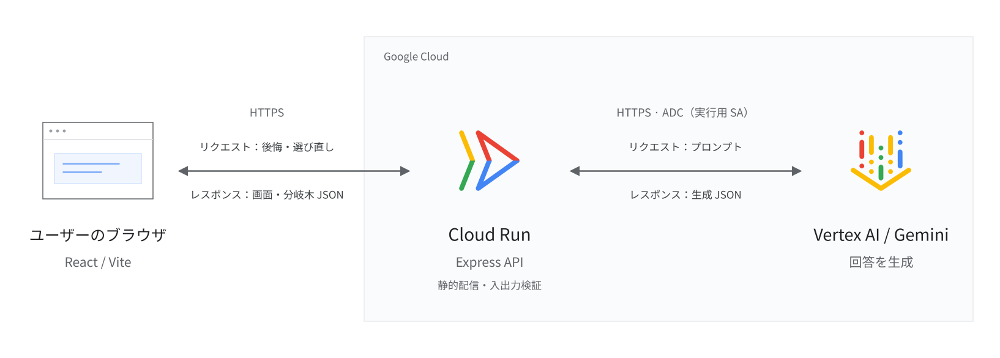

# あとのまつり
**DevFest GDGoC Japan Hackathon 2026 提出作品**  

**カテゴリ**: エンターテイメント  
**チーム**: CCめろん

## 1. プロジェクト概要

「あとのまつり」は、過去の選択への後悔を、別の人生を描く架空の物語へと変えるWebアプリです。後悔を入力すると、「あのとき別の道を選んでいたら」起きたかもしれないユーモラスで散々なストーリーをAIが生成します。物語を眺めながら、今からやってみたいことや、手放せそうな未練を自分の言葉で整理し、後悔と折り合いをつけるきっかけをつくります。

## 2. 解決する課題とアプローチ

### 対象ユーザー
- 進路や仕事、人間関係などの過去の選択への後悔を繰り返し考えてしまう人
- もう一度挑戦したいのか、未練に区切りをつけたいのか、自分でも整理できていない人

### 課題と背景
選ばなかった道の結果は確かめられず、「そっちの道ならうまくいったかもしれない」という想像には答えが出ません。その想像を繰り返すだけでは後悔との折り合いをつけにくいことを、本プロジェクトの課題として設定しています。

### 既存手法との違い・本アプリの特徴
一般的な日記アプリや質問中心の対話型AIでは、「何を期待していたか」「どうしたかったか」など、本人が自分の経験や感情を一から言葉にして説明することが振り返りの中心になります。

一方、「あとのまつり」は実際に経験した人生の不満と、よいことばかりを想像した別の人生を比べてしまう点に着目しています。別の人生を自由に生成する類似サービスに対して、本作はあえて**ユーモラスで散々な展開**に絞り、「あちらならうまくいったはず」という理想化された想像を崩すことを狙います。

- **具体的な展開へのリアクションから始まる振り返り**: 自分の気持ちを一から分析・説明する代わりに、生成された物語に対して「あっちにも面倒はあると思えた」「それでも選びたかった」「物語に納得できない」といった反応を選ぶところから振り返りを始められます。
- **未練と次の一歩の言語化**: 読んだ物語への賛成や反発を手がかりに、「それでも惜しいと感じる部分」と「今からできそうなこと」を自由に記入し、自分の言葉で整理できます。

## 3. 主な機能

- **物語と分岐木の生成**: 後悔している選択を入力（または3つのサンプルデータから選択）すると、選ばなかった道で起きたかもしれない出来事・因果関係・選択肢をユーモラスな物語と分岐図（チャート）として表示します。
- **世界線の分岐・読み比べ**: 分岐図上の任意のポイントから別の行動を選び、それまでの経路（生成済みの世界線）を残したまま新しい展開を再生成して読み比べることができます。
- **振り返りの記録**: 物語への反応、惜しいと感じる部分、今からできそうなことを記入できます。
- **自動保存とファイル出力・復元**: 生成結果と振り返り内容はブラウザ内の `localStorage` に自動保存されるほか、JSONファイルとしての書き出し（エクスポート）や読み込み（インポート）にも対応しています。ユーザー登録やデータベースの準備は不要です。

## 4. 技術スタック・アーキテクチャ

### 技術スタック

| レイヤー | 使用技術 | 用途・役割 |
| :--- | :--- | :--- |
| **フロントエンド** | React / Vite | UI構築、物語・分岐木（チャート）の描画、振り返り入力、ブラウザ保存（`localStorage`）およびJSON入出力 |
| **バックエンド** | Node.js / Express | ビルド済みフロントエンドの静的配信、入出力検証、Vertex AI（Gemini）呼び出しAPIの提供 |
| **AI / LLM** | Vertex AI (Gemini) | 入力内容の判定、選ばなかった道の出来事・因果関係・選択肢の構造化データ（JSON）生成 (`gemini-3.8-flash`) |
| **実行環境** | Google Cloud Run / Docker | フロントエンドとバックエンドAPIを単一のDockerコンテナにまとめ、サーバーレスで実行・配信 |
| **認証基盤** | サービスアカウント / ADC | Application Default Credentials（ADC）と実行用サービスアカウントでVertex AIを呼び出し |

### アーキテクチャ構成



## 5. ローカルで動かす

Node.js **24.22.2**、npm **11.19.1** を使用します。以降のコマンドはリポジトリのルートで実行してください。

Google CloudプロジェクトでVertex AIを利用できること、実行用サービスアカウント、およびそのサービスアカウントを借用する権限が必要です。

### 1. Google Cloud 認証（ADC）の設定
Google Cloud CLIを用意し、自分のアカウントでログインしたうえで、ローカル用のADC（Application Default Credentials）を設定します。  
`YOUR_SERVICE_ACCOUNT_EMAIL` と `YOUR_PROJECT_ID` は、利用する環境の値に置き換えてください。

```sh
gcloud auth login
gcloud auth application-default login --impersonate-service-account=YOUR_SERVICE_ACCOUNT_EMAIL
gcloud auth application-default set-quota-project YOUR_PROJECT_ID
```

### 2. 環境変数の設定
`.env.example` を `.env` にコピーします。

```sh
cp .env.example .env
```

`.env` の次の4項目を設定してください（`GOOGLE_CLOUD_PROJECT` は実際のプロジェクトIDに置き換えます）。

```dotenv
GENERATION_MODE=gemini
GOOGLE_CLOUD_PROJECT=your-gcp-project-id
GOOGLE_CLOUD_LOCATION=global
GEMINI_MODEL=gemini-3.8-flash
```

### 3. ビルドと起動
ビルド後に `.env` を読み込んで起動します。  
`npm start` は `.env` を自動では読み込まないため、実生成では次のコマンドを使用します。

```sh
npm ci
npm run build
node --env-file=.env apps/server/dist/index.js
```

起動後、`http://localhost:8080` からアプリケーションの動作を試すことができます。

## 6. 動作確認・使い方の手順

1. **後悔の入力**: 「選択を入力してください」の入力欄に後悔している選択内容を直接入力するか、下部に用意された3つのサンプルから選択して「生成」を押します（生成完了まで約20秒かかります）。
2. **物語と分岐図の確認**: 画面に生成された物語と分岐図（チャート）を確認します。
3. **世界線の分岐**: チャート上の任意のポイントや「別の選択肢」から別の行動を選び、新しい世界線を生成します。
4. **世界線の読み比べ**: 追加された世界線を切り替えて、それぞれの展開を読み比べます。
5. **振り返りの記入**: ページ下部の「いまのあなたへ・振り返り」から、物語への反応や感想、惜しいと感じる部分、今からできそうなことを記入します。
6. **保存と復元の確認**:
   - ページを再読み込みしても、`localStorage` により結果と記入内容が保持されていることを確認できます。
   - 「保存する」ボタンでJSONファイルとして書き出し、右上メニューの「ファイルから復元」からいつでも読み込めます。
